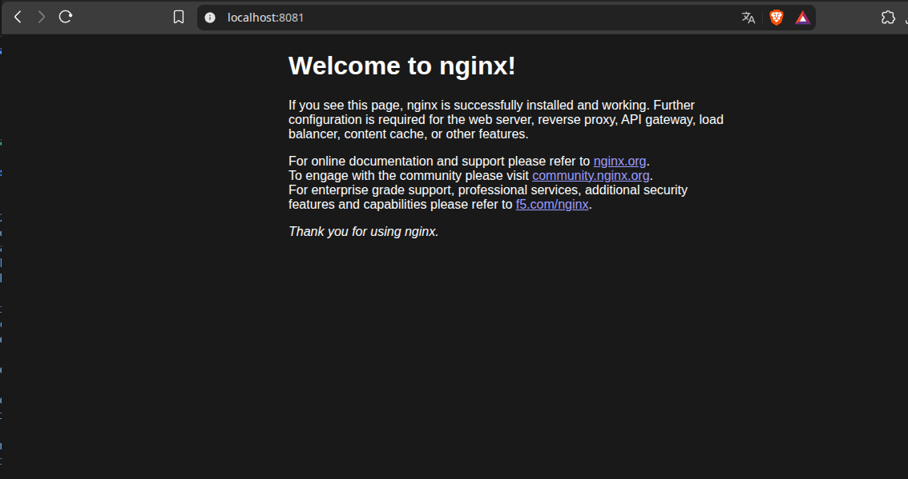
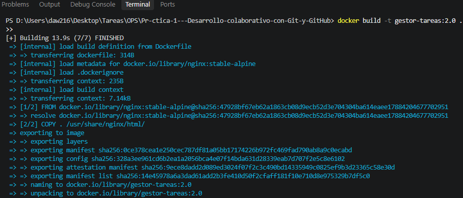
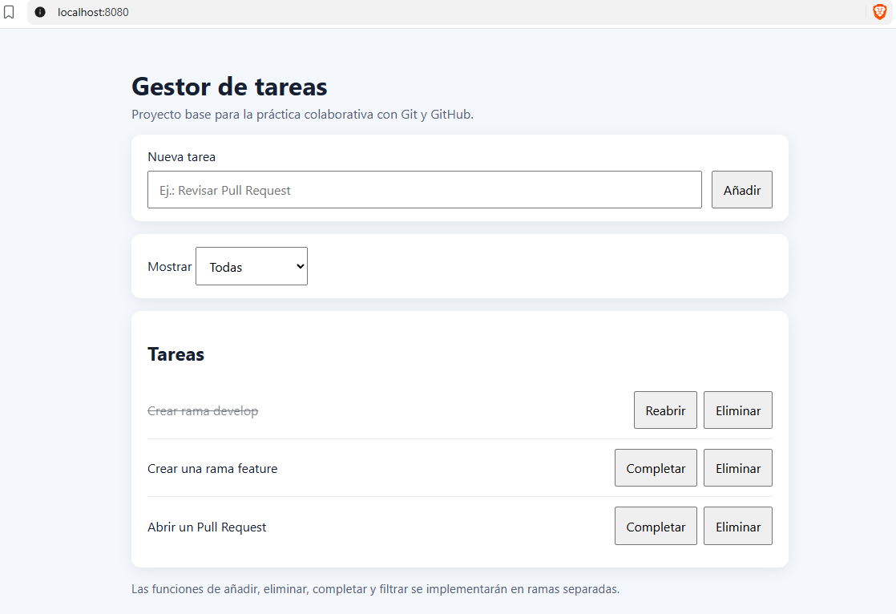
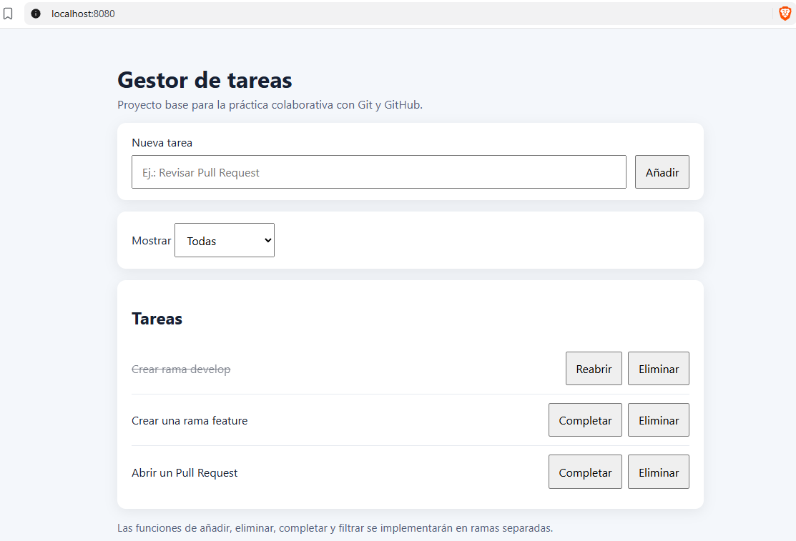

# Evidencias grupales · Práctica 2 Docker

**Equipo:** TODO  
**Integrantes:** TODO  
**Fecha:** TODO

> No hace falta una captura por comando. Bastan resultados breves y explicaciones comprensibles. Las evidencias son del **equipo**.

## 1. Primeros contenedores

- [ ] `docker --version` / `docker compose version` comprobados.
    - Docker version 29.8.2, build 7fc2dff
    - Docker Compose version v5.6.0
- [ ] `hello-world` ejecutado.
            Hello from Docker!
            This message shows that your installation appears to be working correctly.

            To generate this message, Docker took the following steps:
            1. The Docker client contacted the Docker daemon.
            2. The Docker daemon pulled the "hello-world" image from the Docker Hub.
                (amd64)
            3. The Docker daemon created a new container from that image which runs the
                executable that produces the output you are currently reading.
            4. The Docker daemon streamed that output to the Docker client, which sent it
                to your terminal.

            To try something more ambitious, you can run an Ubuntu container with:
            $ docker run -it ubuntu bash

            Share images, automate workflows, and more with a free Docker ID:
            https://hub.docker.com/

            For more examples and ideas, visit:
            https://docs.docker.com/get-started/
- [ ] Nginx accesible en `http://localhost:8081`.
    
    CONTAINER ID   IMAGE                 COMMAND                  CREATED         STATUS         PORTS                    NAMES
fb8590e9641f   nginx:stable-alpine   "/docker-entrypoint.…"   2 minutes ago   Up 2 minutes   127.0.0.1:8081->80/tcp   nginx-prueba

- [ ] Se ha detenido, iniciado y eliminado el contenedor.
    

**¿Qué significa `8081:80`?**
Este parametro aparece en el docker run. Sirve para indicar al contenedor por donde queremos que lanze su sevicion en la maquina anfitriona. Por ejemplo, 8081 hace referencia a el puerto de nuestra maquina. Mientras que el 80 hace referencia a el puerto del servicio original.

## 2. Nuestra imagen

- [ ] Imagen construida con `docker build`.

- [ ] Aplicación accesible en `http://localhost:8080`.

- [ ] Cambio visual comprobado tras reconstruir y recrear el contenedor.

**Comandos y resultados:** 
Se ejecutan los comandos: 
docker stop gestor-tareas
docker rm gestor-tareas
docker run -d --name gestor-tareas -p 127.0.0.1:8080:80 gestor-tareas:2.0
para detener y volver a iniciar el contenedor gestor-tareas tras realizar cambios sobre el html. Como resultado tras reiniciar el contenedor, la aplicación es la misma y no se perciben
los cambios.

**¿Por qué el contenedor antiguo no cambia al reconstruir la imagen?** 
Porque, aunque aunque se haya recargado el contenedor, se está cargando una imagen antigua en la que los cambios no están presentes.

## 3. Persistencia de datos

- [ ] Volumen creado.
- [ ] Un contenedor escribe un archivo en el volumen.
- [ ] Otro contenedor recupera el archivo tras eliminar el primero.

**Comandos y resultado:**
docker volume create datos-devops
docker volume ls
DRIVER    VOLUME NAME
local     41cd7fbda1b42045816bcf9eddbdd2849fa01870d04e64d16697eb9118e8e818
local     02692e1217d6e93abec5e09286eb873e05395e5a0a1d4716027200a809a55a1a
local     datos-devops
local     portainer_data

docker run --rm -v datos-devops:/datos gestor-tareas:2.0 sh -c "echo datospersistentes > /datos/prueba.txt"
docker run --rm -v datos-devops:/datos gestor-tareas:2.0 cat /datos/prueba.txt
datospersistentes

**¿Qué relación tiene esto con las bases de datos?** 
QUe sin volumen, cuando ejecutas una base de datos, los datos se guardan en el propio contenedor; y si este se destruye, se peirden los datos. En cambio con un volumen, los datos se guardan en el disco,asi que aunque se borre el contenedor, los datos se quedan gaurdados.

## 4. Docker Compose

- [ ] Servicios `web` y `proxy` iniciados.
- [ ] La aplicación funciona en `http://localhost:8080`.
- [ ] Se ha consultado `docker compose ps`.
- [ ] Se ha probado la comunicación `proxy` → `web`.

**Comandos y resultado:** TODO

**¿Por qué el proxy se conecta a `web` por su nombre?** TODO

## 5. Incidencias

**Incidencia 1 - Puerto ocupado:** qué ocurrió / cómo lo resolvisteis: TODO

**Incidencia 2 - Imagen no actualizada:** qué ocurrió / cómo lo resolvisteis: TODO

**Incidencia 3 - Servicio incorrecto en Nginx:** qué ocurrió / cómo lo resolvisteis: TODO

## 6. Conclusión del equipo

**Dos cosas que hemos aprendido:** TODO

**Una duda o dificultad que hemos tenido:** TODO

## 7. Colaboración

**Enlaces a Pull Requests relevantes:** TODO
